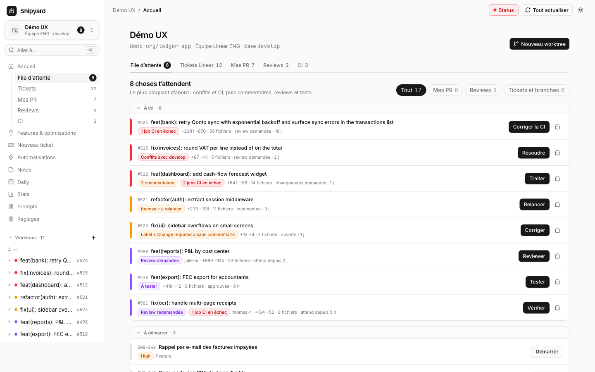
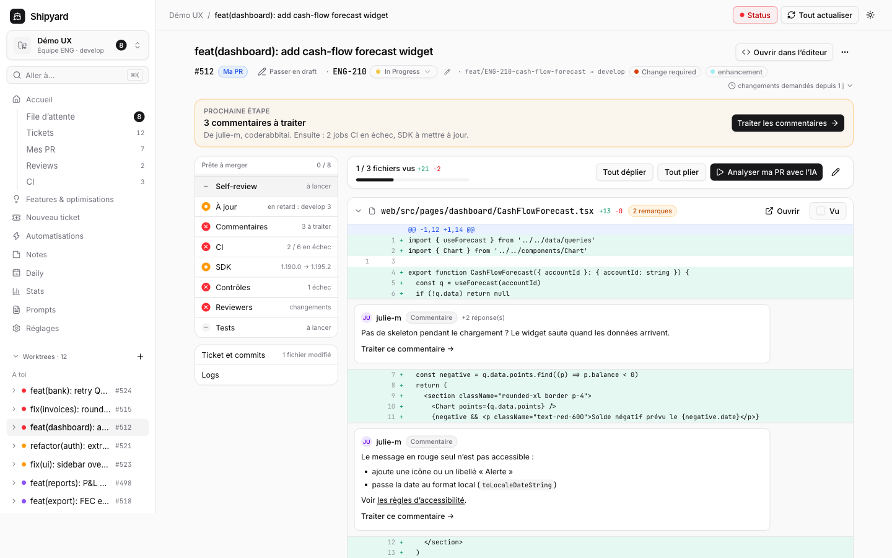
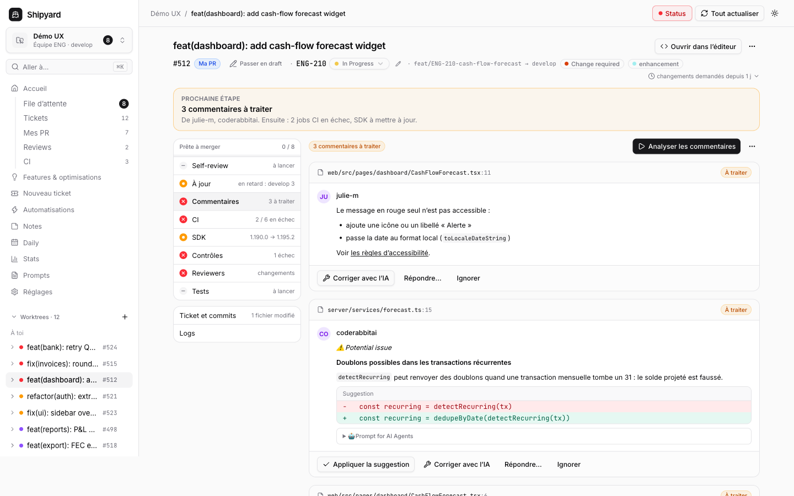

# Shipyard

A local control panel for your day-to-day development work. It brings together your git worktrees, Linear tickets, GitHub pull requests and CI, and drives [Claude Code](https://docs.claude.com/en/docs/claude-code) (`claude -p`) to do the repetitive parts:

- plan and implement a Linear ticket in its own worktree, with before/after screenshots;
- prepare commits and the pull request description, and open the PR, as a draft if you want;
- self-review your branch before or after opening its PR, then fix the findings you accept and verify the fixes in a second pass;
- review a colleague's PR, post the comments you approve as one GitHub review, and pull the author's fixes to review them again;
- triage and fix review comments, CI failures, bot reports and commits rejected by git hooks;
- resolve merge conflicts and keep a branch up to date with its base;
- test a PR in the browser (Playwright) or on an Android emulator, recorded on video, question the agent about what it tested, or prepare a guided manual test;
- write your daily stand-up notes from your GitHub activity.

**Nothing is written to GitHub or Linear without your approval.** Agents never commit, push or post: the server does it once you validate the result in the interface.



| A pull request, step by step | Review comments to triage |
|---|---|
|  |  |

The screenshots show the demo project (`pnpm dev:mock`).

> The interface is in French. The language of what the agents write (analyses, GitHub comments, PR descriptions, tickets) can be set to English or French in the settings.

## Requirements

- macOS (notifications and a few helpers use macOS tools; the rest is portable but untested elsewhere)
- Node.js 24 and pnpm 10
- [Claude Code](https://docs.claude.com/en/docs/claude-code), logged in (`claude`): runs on your Claude subscription, no Anthropic API key needed
- [GitHub CLI](https://cli.github.com/), logged in (`gh auth status`)
- A Linear personal API key (Linear › Settings › Security & access › Personal API keys), optional if you don't use Linear
- Optional: Google Chrome (browser tests and test videos), the Android SDK (mobile tests), the Xcode command line tools (`swiftc`, richer notifications)

## Getting started

```bash
git clone <this repository> shipyard && cd shipyard
pnpm install                  # also installs the git hooks (lefthook)
cp .env.example .env.local    # then fill in LINEAR_API_KEY and, if you like, your folders
pnpm dev                      # API on 127.0.0.1:4317, interface on http://localhost:5173
```

Open http://localhost:5173 and add a project from its GitHub URL. Keys can also be set later from **Réglages › Connexions**; they are checked, then stored in `.env.local`.

To run it without the dev tooling: `pnpm build && pnpm start`, then open http://localhost:4317.

A demo project with fake data is available with `pnpm dev:mock`: it needs neither GitHub, Linear nor Claude, and nothing is sent or launched from it.

## Configuration

| Variable | Default | Purpose |
|---|---|---|
| `LINEAR_API_KEY` | — | Linear personal API key |
| `GH_TOKEN` | `gh` login | GitHub token, if you don't want to use the `gh` login |
| `PORT` | `4317` | API port (the Vite dev server always uses 5173) |
| `WORKTREE_ROOT` | `~/shipyard/worktrees/{project}` | Where new worktrees are created |
| `PROJECTS_ROOT` | `~/shipyard/projects` | Where a project added without a local path is cloned |
| `PANEL_URL` | `http://localhost:5173/` | Opened when you click a notification |

## Making it yours

Everything the agents are told lives in Markdown files you can edit from the **Prompts** page:

| Folder | Content |
|---|---|
| `prompts/*.md` | One prompt per AI action. The front matter sets the model, the permission mode and the allowed tools. |
| `prompts/_system.md` | Common rules appended to every agent. |
| `agents/*.md` | Optional sub-agents (four specialised reviewers: architecture, quality, security, performance). A prompt gets them by listing their names in its front matter (`agents: [reviewer-quality, …]`); no shipped prompt does by default. |
| `rules/*.md` | Your team's development rules, applied by reviews and fixes. Each rule lists the projects it applies to. |

Your changes never touch the shipped files: they are saved in `prompts.local/` and `rules.local/`, which git ignores. A local file replaces the shipped one with the same name, and **Revenir au prompt par défaut** removes it. Put your team's own rules in `rules.local/` (or create them from the Prompts page): they stay on your machine.

### Backing up your local files

`prompts.local/`, `rules.local/` and your data never reach the public repository. To keep a copy, or to work from a second machine, point a remote named `private` at a private repository of your own:

```bash
git remote add private <url of your private repository>
pnpm private:push     # the code of HEAD plus your local files, as one commit on its main branch
```

Once the remote exists, every `git push` also updates the backup (it never blocks the push). On another machine, clone this repository, add the same remote, then run `pnpm private:pull` to bring your local files back.

`prompts.local/` and `rules.local/` are always included. List anything else in a `private.local` file, one path per line (for example `.env.local` or `.data/settings.json`); it is ignored by git and backed up too. Only do this with a repository that is really private: `.env.local` holds your keys.

## How agents are run

Each action starts `claude -p` in the relevant worktree with:

- **a lean profile** (`--setting-sources project,local --strict-mcp-config`): your global hooks and plugins are not loaded, which keeps the start-up cost low;
- **precomputed context**: the server fetches the diff, comments and CI logs and puts them in the prompt, so the agent doesn't spend turns looking for them;
- **structured output** (`--json-schema`), displayed as is by the interface;
- **minimal permissions**, set in each prompt's front matter: analyses are read-only, fixes get `acceptEdits` and the project's lint and test commands;
- **no remote writes**: commits, pushes, replies, reviews and PRs are done by the server after your approval;
- **big diffs reviewed in batches**: beyond a reasonable size a review is split, one agent per batch in parallel, then a last agent reads all the findings together, removes duplicates and contradictions and looks for what crosses the batches;
- **context passed from one agent to the next**: a fix knows the branch (ticket, commits, earlier fixes) and stays inside the files the PR changes; a second self-review pass knows what the first one raised, what was fixed, declined or dismissed, and only reports real problems.

Runs are streamed live (SSE) and saved in `.data/runs/`. Reloading the page brings every screen back to its last run, and **Arrêter** stops `claude` and everything it started.

## Security model

Shipyard runs agents that edit code on your machine, so the API only accepts the local interface:

- it listens on `127.0.0.1` only;
- it rejects unknown `Host` headers (DNS rebinding), other origins, cross-site requests (`Sec-Fetch-Site`) and non-JSON bodies;
- every request body is validated before reaching the business logic.

Do not expose the port to a network. Your keys stay in `.env.local` and your data in `.data/`, both ignored by git.

## Project layout

| Folder | Role |
|---|---|
| `server/` | Hono API. `routes/` holds the routes by domain, `inputs.ts` validates request bodies (zod), `actions.ts` dispatches AI actions to `actions/<domain>.ts`, `services.ts` holds the business logic and `lib/` the integrations (git, gh, Linear, the `claude -p` runner, run storage). |
| `web/` | React 19 interface (Vite, TanStack Query). |
| `shared/` | Data contract between the server and the interface. |
| `prompts/`, `agents/`, `rules/` | What the agents are told (see [Making it yours](#making-it-yours)). |
| `mock/` | Demo data for `pnpm dev:mock`, generated by `pnpm mock`. |
| `scripts/` | Command line helpers (private backup). |
| `docs/` | Screenshots of this page. |

## Development

```bash
pnpm typecheck   # TypeScript
pnpm lint        # Biome
pnpm test        # Vitest
pnpm build       # production build of the interface
```

Typecheck and lint run before each commit, tests and build before each push (lefthook), along with the private backup if you set one up. See [CONTRIBUTING.md](CONTRIBUTING.md).

## License

[MIT](LICENSE)
